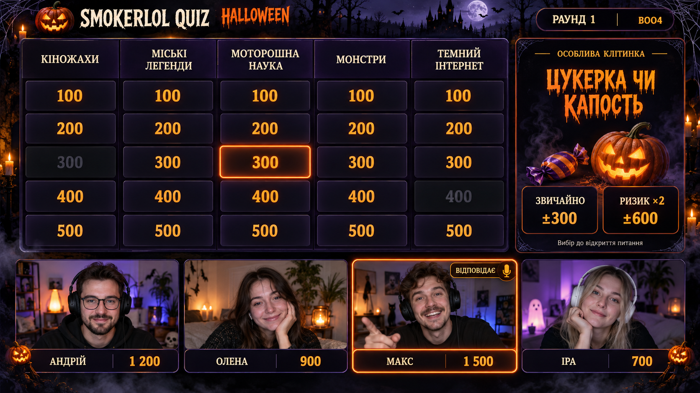
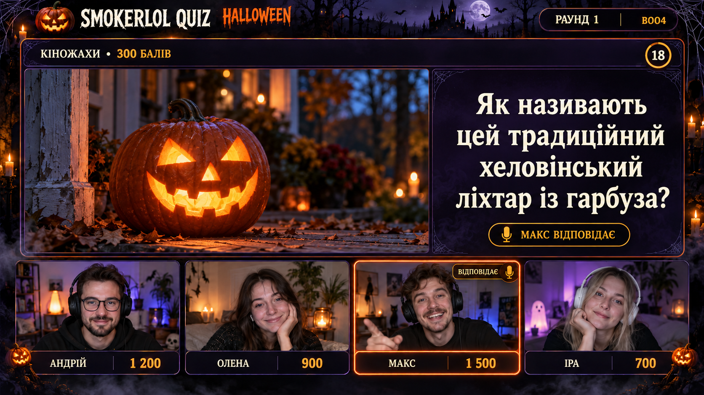

# Halloween

Дата концепції: **25.10.2026**. Запланована гра: **субота, 31.10.2026**.

**Статус на 28.10.2026:** UI HOST і PLAYER, спільний перегляд усіх трьох екранів, керування темою та тематична форма входу опубліковані в `origin/main` комітом [`b3ca4b8`](https://github.com/smokerlol111/mygame/commit/b3ca4b8d6c49d3ca480340c876a4bfc90b668af8); [контрольна точка й перевірки](../../CHANGELOG.md#28102026--halloween-коміт-і-публікація-ui-та-перемикання-теми). Деплой не перевірений. OBS зберігає художнє оформлення й постійні місця камер/чату/донатів. Чернетка набору Halloween заповнюється окремо та прихована в каталозі; `uiTheme` їй поки не призначено. Поточний етап — оформлення; реальна гра й нова механіка цим етапом не вмикаються.

За уточненням власника додана постійна права колонка під **його камеру, чат і донати**. Основне поле/питання та нижній ряд камер гравців розташовані зліва від цієї колонки.

## Перегляд реалізації

Для PLAYER також доступний етап **«Вхід»** — `/themes/halloween/preview.html?target=player&view=login` або окрема сторінка `/play?preview=halloween&view=login`. Це демонстрація справжньої форми входу зі стандартними розмірами й тематичними кольорами.

На запущеному локальному сервері відкрийте `/themes/halloween/preview.html`. Наприклад, якщо використовується порт 3100: `http://localhost:3100/themes/halloween/preview.html`.

У перегляді оберіть **OBS**, **HOST** або **PLAYER**, потім лобі, поле, фото, текст, BUZZ, відповідь або паузу. PLAYER у галереї показується в рамці телефона шириною до 390 px; без рамки можна відкрити `/play?preview=halloween&view=board`. Це справжні `screen.html`, `host.html` і `play.html` на демонстраційному стані. Ігрові кнопки в прикладах неактивні; **кнопка теми працює тільки у HOST**. Вибір теми зберігається в адресі перегляду й переноситься при переході між OBS/HOST/PLAYER. Перегляд не створює кімнату, не підключає реальний сокет і не змінює збережені сесії чи гучність. Параметри `room`, `code` або `key` вимикають демонстраційний транспорт, щоб він не підміняв реальний вхід.

Прямі адреси: `/themes/halloween/preview.html?target=host&view=board`, `/themes/halloween/preview.html?target=player&view=buzz`, `/themes/halloween/preview.html?target=obs&view=photo`. Для фото використаний наявний файл `public/media/surprise_tibetan_fox.jpg`; демонстраційні питання не додані до набору гри.

Скриншоти фактичної сторінки в Microsoft Edge без вікна, 1920×1080:

- [Поле](previews/obs-board.png).
- [Питання з фото](previews/obs-photo.png).

Нові скриншоти фактичних сторінок (Edge без вікна):

- HOST, 1280×1080: [поле](previews/host-board.png), [фото й керування BUZZ](previews/host-photo.png).
- PLAYER, 390×844: [поле](previews/player-board.png), [фото](previews/player-photo.png), [відкритий BUZZ](previews/player-buzz.png), [пауза](previews/player-paused.png).
- PLAYER, 320×740: [фото](previews/player-photo-320.png), [довге питання з вертикальним прокручуванням](previews/player-long.png).
- PLAYER, 1920×1080: лобі — [стандартна тема](previews/player-lobby-desktop-standard.png) / [Halloween](previews/player-lobby-desktop-halloween.png); поле — [стандартна тема](previews/player-board-desktop-standard.png) / [Halloween](previews/player-board-desktop-halloween.png).
- PLAYER, форма входу: порівняння 1920×1080 — [стандартна тема](previews/player-login-desktop-standard.png) / [Halloween](previews/player-login-desktop-halloween.png); [справжнє отримання теми кімнати перед входом, 1280×900](previews/player-join-halloween.png).

HOST має тематичну шапку, кольори кнопок зі збереженням значень «правильно/неправильно», читабельні категорії й картки гравців. **У PLAYER всі розміри й розташування відповідають стандартній темі:** ширина панелі, відступи, шрифти, кнопки, BUZZ, фото, відео та поля вводу. Halloween змінює кольори, фон і декор; окрема велика шапка та обмеження ширини 580 px прибрані. На широкому екрані зберігається стандартна ширина, на телефоні — стандартні мобільні правила, включно з правилами для сенсорного керування. Прокручування фото й довгих питань працює так само, як у стандартній темі.

Оформлення перероблене за початковим ескізом: ілюстрований фон із замком, місяцем і туманом, павутиння та свічки по краях, прозорі гарбузи на шапці й рамках, тематичний заголовок Creepster, кириличний текст Georgia, фактура панелей і помаранчеве світіння вибраної клітинки. У демонстрації поля вибрана клітинка 300 показує цей ефект; це лише демонстраційний стан. [Ресурси, джерела та промпти](ARTWORK.md).

## Підключення до окремої гри

У HOST біля коду кімнати є кнопка **«🎃 Halloween» / «🌙 Стандартна тема»**. Вона змінює оформлення HOST, PLAYER та OBS цієї кімнати без перезавантаження. На PLAYER й OBS кнопки немає; сервер приймає команду лише від ведучого відповідної кімнати. Вибір зберігається протягом життя кімнати та відновлюється після перепідключення. Нова кімната використовує тему з JSON гри.

Щоб Halloween був початковою темою конкретної гри, додайте поле верхнього рівня:

```json
"uiTheme": "halloween"
```

Сервер передає тільки дозволену назву теми. Без цього поля або з невідомою темою початковим є стандартне оформлення. Ручний вибір HOST має пріоритет над початковою темою гри. HOST і PLAYER отримують тематичні кольори; OBS — окреме компонування з камерами. Окрема подія оформлення зберігає поточні поля відповідей, фокус і медіаелементи.

Зміни JSON ігор підхоплюються при старті сервера; його перезапускають між іграми, оскільки активні кімнати зберігаються в пам'яті. Кнопка теми в уже створеній кімнаті працює без перезапуску.

## Тема на формі входу

Коли гравець відкриває `/play?room=КОД`, форма входу отримує поточну тему цієї кімнати до натискання «Увійти». Якщо надіслано тільки код, тема з'являється після введення всіх чотирьох символів. Ім'я й фокус не скидаються, розміри форми залишаються стандартними.

Окремий запит `getRoomTheme` через наявний Socket.IO повертає тільки `ok`, `code` і дозволену назву теми. Він не додає гравця, не підписує на ігрові події й не передає запитання чи відповіді. Неповний та незмінений код не створює повторних запитів; при зміні коду або перепідключенні виконується нова разова перевірка. Періодичного опитування немає. Запізніла відповідь для попереднього коду або після успішного входу ігнорується. Для невідомої кімнати лишається стандартне оформлення та звичайна перевірка під час входу.

`node tests/ai_repro/player_join_theme.js --browser` — PASS: справжня форма входу в Edge, один початковий запит (враховано HTTP polling і WebSocket), за 3,5 с спокою — без повторних перевірок і завантажень теми. Основний сценарій також перевіряє ручний код, відсутність місця/підписки до входу, збереження імені/фокуса та захист від старих відповідей. З формою входу браузерна звірка геометрії охоплює 50 порівнянь на 320/390/768/1280/1920 px.

## Трафік і повторні оновлення

Тема не опитується через HTTP або таймер: клієнт читає її з уже отриманого стану кімнати, а реальну зміну отримує окремою подією. Повторний вибір уже активної теми сервер підтверджує без нової розсилки. Клієнт також пропускає дублікати події. Чинна синхронізація часу й Socket.IO heartbeat працюють окремо від теми.

Шапка та емблема залишаються тими самими DOM-вузлами; змінюються тільки текстові поля. Камери перебудовуються лише коли змінилися їхні дані. Підбір шрифту питання повторюється при зміні тексту, розмірів або компонування.

`node tests/ai_repro/halloween_theme.js --traffic` перевіряє три справжні вкладки Edge на ізольованому сервері. Вимір 28.10: за 3,5 с спокою — 0 HTTP-запитів теми та 0 команд її перевірки; 500 однакових оновлень OBS — 0 перебудов шапки/камер і 0 завантажень теми. Окремі 500 оновлень фото-компонування — 0 DOM-змін і 0 завантажень. Двадцять повторних команд активної теми не дали нових розсилок. Одне перемикання — одна команда HOST та по одній події на HOST/PLAYER/OBS; у виміряному переході до стандартної теми подія займала 51 байт даних Socket.IO, без транспортних накладних витрат і без повного стану гри.

Це локальний вимір, не перевірка реальних телефонів/OBS або повільного інтернету. Початкове завантаження графіки лишається: фон та емблема разом мають приблизно 3,77 MB; цей вимір підтверджує відсутність зайвих повторних запитів, а не нульовий початковий трафік.

## Камери в OBS

1. Додайте `/screen/КОД` як Browser Source з розміром 1920×1080.
2. Додайте відео кожного гравця окремим джерелом **вище** Browser Source у списку джерел OBS. Розмістіть відео всередині відповідного прямокутника, залишивши видимими зовнішню рамку й нижній підпис із рахунком. Бейдж усередині відеозони може бути закритий відеоджерелом; зовнішнє підсвічування залишається видимим.
3. Зіставте камери з гравцями до старту. HOST показує номер камери в картці гравця. Номери 1–4 призначаються за порядком першого входу; сервер зберігає `cameraSlot` 0–3 за ID гравця протягом життя кімнати.
4. Сортування після розіграшу першого ходу та повернення із секретним ключем не змінюють місце. Тимчасове відключення зберігає місце; ручний вихід звільняє його. У лобі новий учасник отримує вільне місце.

Порожні місця не зсувають решту камер. Повідомлення про присутність і голос оновлюють рамки без перебудови питання чи медіа. Автоматичне отримання або перемикання відеопотоків не реалізоване; фактичне джерело відео ще потрібно вибрати.

**Розміри джерел:** для гри — Browser Source **1920×1080**; для окремого відеопосилання VDO.Ninja можна задати **1280×720**, а потім вписати його зі збереженням пропорцій у відеовікно приблизно 341×195 px (кадр 16:9 займає приблизно 341×192 px). Не перекривайте рамку та нижній підпис. Розширення браузера для цього не потрібне: посилання перегляду додається безпосередньо у джерело «Браузер» OBS. [Опис Browser Source](https://obsproject.com/kb/browser-source), [VDO.Ninja basics](https://docs.vdo.ninja/getting-started/vdo.ninja-basics).

**Говоріння, 30.10.2026:** замість зміни кольору тонкої рамки камера отримує зовнішній зелений контур 4 px зі світінням і зелений підпис зі світлим ім'ям/рахунком. Контур лежить зовні відеовікна, тому окреме джерело відео не повинне його закривати. Розміри й координати не змінюються. Для гравця, який відповідає, зберігається помаранчева межа; при неправильній відповіді підпис лишається червоним, зелений зовнішній контур продовжує показувати голос. Після завершення говоріння оформлення відновлюється.

Сигнал говоріння надходить із Discord через наявну прив'язку гравця до Discord ID; VDO.Ninja не додає такої прив'язки автоматично. [Приклад підсвітки](previews/obs-speaking.png) з непрозорими прямокутниками поверх відеовікон — макет джерел, а не справжній OBS/відеопотік. Підсвітку й аудит камер внесено до `main` комітом [`e7485a9`](https://github.com/smokerlol111/mygame/commit/e7485a9518e7d5484509782d1b05d17e1899bc05), push успішний 30.10.2026; [актуальний журнал](../../CHANGELOG.md#30102026--obs-коміт-і-публікація-підсвітки-та-аудиту-камер). Деплой і реальні OBS/камери не перевірені. Перед переглядом оновіть кеш ігрового Browser Source.

## Камера ведучого, чат і донати

Права колонка відведена під три окремі джерела OBS:

- **Вгорі — камера ведучого:** вікно 16:9 під заголовком «КАМЕРА ВЕДУЧОГО».
- **Посередині — чат:** найбільша вертикальна зона під заголовком «ЧАТ».
- **Внизу — донати:** окрема зона під заголовком «ДОНАТИ».

Додайте свою камеру та джерела чату/донатів вище ігрового Browser Source у списку джерел OBS і розмістіть їх у відповідних вікнах, залишивши видимими заголовки й рамки. Сторінка резервує місце, але не підключає акаунти, віджети чи платіжні сервіси. До налаштування джерел у вікнах показуються текстові заглушки.

Колонка займає приблизно 21% ширини кадру 1920×1080 та простягається від шапки до нижнього краю. Камери гравців залишаються під ігровою частиною зліва й не заходять у колонку. Права колонка монтується один раз: зміна ігрової фази, пауза та повідомлення про присутність не перебудовують її вміст. Вона прибирається при скиданні теми.

Реальне підключення вашої камери, чату й донатів у OBS ще не виконувалося. Джерела, їхні посилання та відображення потрібно налаштувати окремо.

## Ескізи OBS

### Поле гри



### Питання з фото



Ескізи створені вбудованим інструментом генерації зображень `imagegen` у цій розмові. Люди, імена, рахунки, категорії та питання на них — ілюстративні приклади, а не готовий контент гри. PNG є цілісними макетами, не готовими прозорими рамками для OBS.

## Задум оформлення

- Темний фіолетовий фон, помаранчеві акценти, гарбузи й павутиння по краях.
- Верхня частина OBS: поле; після вибору — питання або медіа. Для фото запропоновано велике зображення зліва та текст справа.
- Нижня частина OBS: чотири постійні місця під камери, імена та рахунки, відповідно до поточного ліміту сервера. Якщо учасників менше, решта місць лишаються порожніми.
- Права колонка OBS: камера ведучого, чат і донати, які залишаються на місці під час зміни ігрових екранів.
- Камера гравця, який відповідає, підсвічується. Відео додається окремими джерелами OBS; автоматичного отримання камер у грі наразі немає.
- На екрані питання блок спецмеханіки поступається місцем контенту.
- PLAYER: тематичні кольори та читабельна кнопка BUZZ, без порожніх місць під камери.
- HOST: тематична шапка з номером раунду, кольори керування, поле та рахунки; чинні обробники дій збережені.

## Запропонована механіка

**«Цукерка чи капость»**: на спеціальній клітинці гравець до відкриття питання обирає звичайний номінал або подвійний виграш / подвійний штраф.

Це пропозиція з обговорення, а не затверджене правило. Кількість клітинок, взаємодію з наявними спецклітинками та точні правила ще потрібно визначити. Сервер, HOST, PLAYER й OBS цю механіку наразі не реалізують.

## Подальша реалізація

Наступні етапи: завершити окремий набір питань, узгодити правила нової механіки та налаштувати реальні відеоджерела. Потрібна перевірка у справжньому OBS і на телефонах, з реальним відтворенням аудіо/відео та межею STOP.

## Виконані перевірки

- `node tests/ai_repro/halloween_theme.js` — ізольований сервер: сортування першого ходу, перепідключення й звільнення місця; фактична OBS-сторінка в jsdom: фото, прихована відповідь, екранування імен, 18 фаз, збереження вузла відео й чинного STOP-обмеження, постійна колонка камери/чату/донатів зі збереженням її вмісту та прибиранням після скидання теми; Grand Final без теми й без нової колонки.
- `node tests/ai_repro/halloween_theme.js --screenshots` — додатково зроблено й переглянуто скриншоти браузера 1920×1080; це не перевірка OBS або декодування медіа.
- **Початковий UI-етап 28.10:** сценарій розширено на HOST/PLAYER: 25 клітинок на кожній сторінці, стани BUZZ, скидання теми, збереження відеовузла, сесій і налаштувань; параметри реальної кімнати не активують демо. Після уточнення власника розміри PLAYER звіряються зі стандартною темою, а попередня окрема мобільна геометрія більше не застосовується.
- **28.10, розміри PLAYER:** `node tests/ai_repro/halloween_theme.js --player-layout` і `--screenshots` — PASS: 45 порівнянь стандартної та Halloween-тем на 320/390/768/1280/1920 px, із сенсорним і звичайним керуванням. Перевірені лобі, поле, фото, BUZZ, довгий текст, пауза, відео, ставка та введення фінальної відповіді. Для всіх елементів звіряються координати/розміри, відступи, рамки, шрифти й параметри компонування. Збережено 14 скриншотів, включно з порівняннями лобі/поля на широкому екрані.
- **28.10:** `player_join_regression.js` — PASS; `host_reload_repro.js` — помилку перезавантаження HOST не відтворено. Повторних перевірок реальних телефонів/OBS не виконували.
- **28.10, кнопка теми:** `halloween_theme.js --screenshots` — PASS: кнопка лише у HOST, перемикання всіх трьох справжніх сторінок, заборона команд гравця/ведучого іншої кімнати, відхилення невідомих тем, ізоляція кімнат, відновлення вибору після перепідключення, збереження введеної відповіді/фокуса, таймера й позиції відео; вибір у перегляді переноситься між екранами. `game_safety_regression.js` і `player_join_regression.js` — PASS; помилка `host_reload_repro.js` не відтворена.
- `game_safety_regression.js`, `season_grand_final.js`, `player_join_regression.js` — пройдені ізольовані регресії.

Базову тему раніше опубліковано комітом `f82b91de7056855650b6b00f0cd850de07d33949`. Допрацювання UI від 28.10 поки локальне: коміт, push і деплой цього етапу не виконані; користувацький сервер не перезапускався, виробничі дані не змінювалися.
